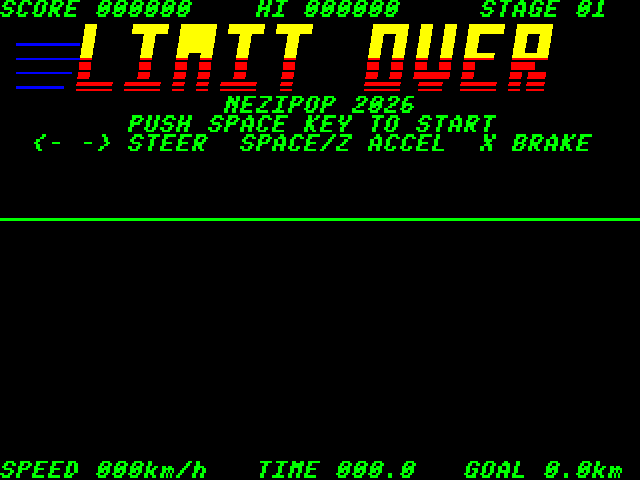
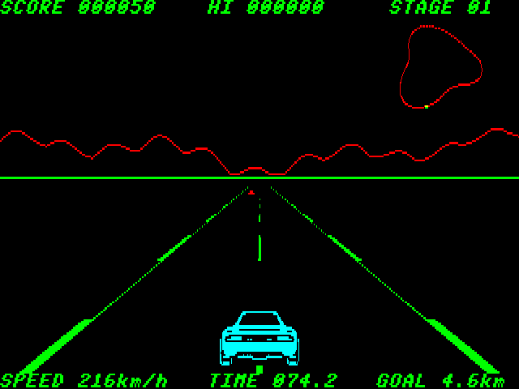
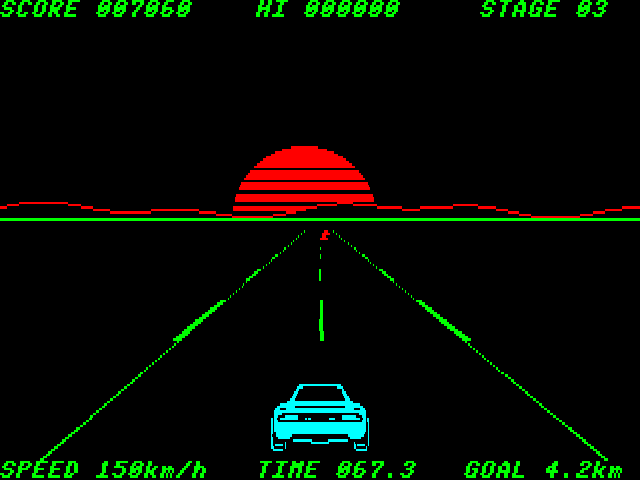
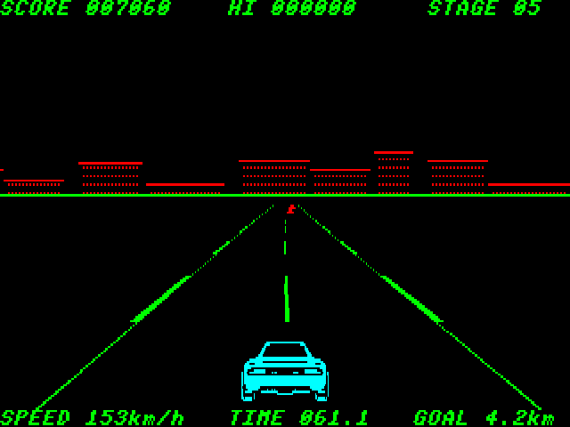
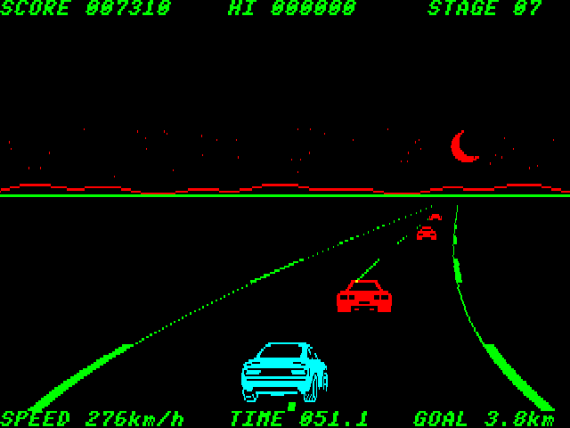
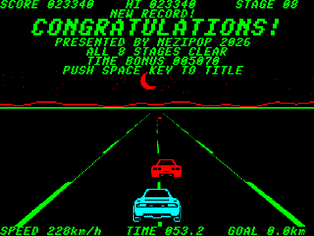

# LIMIT OVER - 3D CAR RACE

シャープ **MZ-2000 / MZ-2200** 用のオリジナル 3D カーレースゲームです。Z80 のアセンブラで書いています。
制限時間内にゴールを目指して、全 8 ステージを走りきってください。

| ステージ 1・2(山) | ステージ 3・4(夕日) |
|---|---|
|  |  |
| **ステージ 5・6(夜の街)** | **ステージ 7・8(星空)** |
|  |  |

## 動作環境

- シャープ MZ-2000 / MZ-2200(グラフィック RAM の 3 面を使います)
- 実機の MZ-2000・MZ-2200 と、エミュレータ EmuZ-2200 で動作を確認しています。

## ファイル

| ファイル | 内容 |
|---|---|
| `RACE040.d88` | ディスクのイメージ。IPL で起動します |
| `RACE040.mzt` | テープのイメージ(MZT 形式) |

ファイル名の数字は版の番号です。

## 遊び方

### 操作

| キー | 動作 |
|---|---|
| ← → | ハンドル(テンキーの 4・6 でも可) |
| SPACE / Z / ↑ | アクセル |
| X / ↓ | ブレーキ |
| P | 一時停止(もう一度 P で再開) |

タイトル画面で SPACE を押すとゲームが始まります。

### ルール

- 3・2・1・GO の合図でスタートします。
- 画面の右上に、いま走っているコースの地図が出ます(赤い線がコース、緑の点が自分の車)。
- 各ステージは 1 周(約 4.7 km)です。**制限時間内にゴールのアーチをくぐるとステージクリア**です。
- 残り時間はボーナス得点になります。時間は次のステージへ持ち越しません。
- TIME が 0 になるとアクセルが効かなくなり、車が止まると GAME OVER です。
- **ステージ 8 をクリアするとゴール**です。

### コース

景色とコースは 2 ステージごとに替わります。新しいコースの地図は、ステージクリアの間に描かれていきます。

| ステージ | 景色 | コース |
|---|---|---|
| 1・2 | 山 | 基本のコース |
| 3・4 | 夕日 | 長くゆるいカーブの高速コース |
| 5・6 | 夜の街 | 短い S 字が続くコース |
| 7・8 | 星空 | きついカーブが多い、一番難しいコース |

制限時間はステージ 1 が 76 秒です。ステージごとに 3 秒ずつ短くなり、ステージ 6 は 61 秒です。ステージ 7・8 は 66 秒です。

### ライバル

ライバルは 3 台です。抜くと、また前の方に現れます。

- **ブロッカー**: 前に回り込んで進路をふさいできます。
- **スプリンター**: 近づくと加速して逃げます。

抜かれたライバルは、加速して抜き返してきます。
速さの差が大きいまま追突するとスピンします。ブレーキで速さを合わせてから当たれば、軽い接触で済みます。

### 得点

| 得点 | 条件 |
|---|---|
| 10 点 | 少し(1 単位)走るごと |
| 100 点 | ライバルを 1 台抜く |
| 残り 1 秒あたり約 100 点 | ゴールしたときのタイムボーナス |

HI スコアを更新すると NEW RECORD! と表示されます(HI スコアは電源を切ると消えます)。

## 特徴

- 道路・ライバル・景色を描く処理はすべて機械語です。1 秒に約 21〜29 コマで動きます。
- 景色は地平線の上を、カーブと左右の動きに合わせて横に流れます。
- コースの地図(鳥瞰図)は、コースの曲がりのデータから計算して描いています。レース中は自分の車の点を動かすだけなので、走りの速さは変わりません。
- 曲はビープ音で 3 声を同時に鳴らします。1 秒に約 23,000 回、3 つの声が順番にスピーカーを切り替えて混ぜています。
- 画面の文字とタイトルのロゴは、この作品のためにデザインしたオリジナルです。
- 曲(タイトル・ゲームオーバー・エンディング)もオリジナルです。

## クレジット

- 制作: NEZIPOP(2026)
- 開発には Claude(Anthropic)を使用しました。
